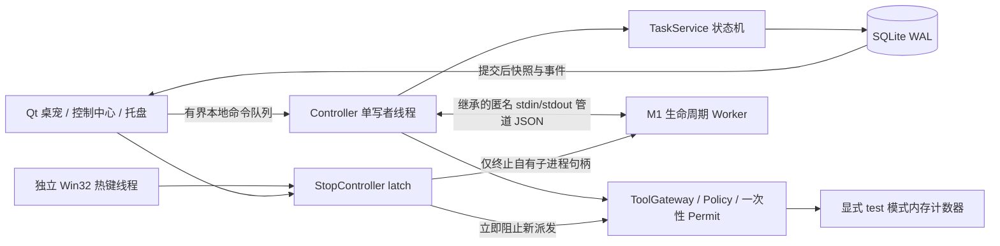

# Mavis M0/M1 实际架构

**M3/M4 增量：** 语音独立worker复用私有IPC，最终ASR进入原Controller/TaskService。控制中心通过同一写者的history/details/CRUD命令读取SQLite，设置持久化与诊断预览/导出亦由Controller处理，UI只收queued事件。非秘密设置只更新未来Task，创建时记录配置事件。动画桥查找上游实际素材，独立临时呈现抑制位不覆盖用户显隐或clip状态。详见 [M3](reports/M3_VOICE_E2E.md) 和 [M4](reports/M4_UI_ACCEPTANCE.md)；M4按用户要求尚未做统一功能验收。下文M0/M1描述为历史快照，新增能力以最新报告为准。

M2 增量：[ADR-002](adr/002-m2-controlled-pilot.md) 与 [实机报告](reports/M2_DESKTOP_E2E.md)。Controller 接入默认关闭的 session-only Notepad 授权；NativeTasks 仍复用同一 TaskService/ToolGateway/Store，增加跨进程 lease、原生观察和独立 verifier。当前原生调用在 Controller 线程，UI 线程不阻塞，但可独立强杀的原生 worker 尚未交付，不能按完整目标架构验收。

2026-11-02；关联 [上游映射](UPSTREAM_BASELINE.md)、[数据契约](DATA_SCHEMA.md)、[当前状态](IMPLEMENTATION_STATUS.md)。

`python -m assistant` 设置独立命名空间后进入上游 `pet.app.main`，保持既有渲染与交互。仅在 Mavis 模式增加助手、禁用上游可选能力并跳过旧缓存/注册表清理。`--core-only` 是排障入口，与主入口共享上游单实例锁。

Qt 主线程不做 SQLite、API、ASR 或 worker 等待。Controller 线程创建/关闭 SQLite；窗口只收提交后的 queued Qt 信号。桌宠事件桥同样显式 queued，使用上游气泡呈现面。当前没有百分比进度或“正在操作电脑”的虚假提示。

TaskService 是状态真源：一个活动任务；终态不复活；取消/暂停撤销许可并递增 generation；暂停请求与后端停止确认分开；恢复必须提供新观察，M1 尚无重新规划器，所以演练恢复诚实结束并要求新任务。SQLite 唯一活动任务索引是第二道约束。

审批属于 Host 本地 UI 权限对象。worker 协议没有 approve、policy、success、任意函数或可执行文本消息。Permit 只活在内存，绑定 task/generation/tool_call/参数摘要/context/scope version/单调时钟截止，一次消费；失败也不恢复令牌。每个动作的意图、开始事件落库后才可调用 backend；写入失败先置停止闩锁。

结果由独立 Verification 决定，`ToolResult.status=ok` 不足以成功。缺失目标/证据、视觉或用户自述单独确认不会生成机器独立验证成功。测试模式的 fixture 结果只能在 `mode=test`，写 `state-test.db`；正式模式写 `state.db`。

IPC 用固定模块子进程及继承的匿名 stdin/stdout，未监听任何端口。不使用 pickle 或动态命令分派；消息有 64 KiB 上限、严格 schema、会话 nonce、方向、task/generation、连续 seq。子进程环境只继承有限系统变量，不继承模型 API Key。EOF/错误/重放使 worker 失效，Host 不能把它当作任务成功。

急停使用独立线程的 `RegisterHotKey(Ctrl+Alt+F12)`，失败如实显示。StopController 不等 LLM/Controller，先置 latch 再终止自己持有的 worker。UI 立即显示闩锁状态，数据库收尾随后完成。M1 没有按下任何真实系统按键，因此不声称已验证真实按键释放；真实输入的 finally 释放、会话锁屏通知属于进入 M2 的前置补全。

这不是恶意插件沙箱，也不对抗同一 Windows 用户权限下的恶意进程。当前 worker 只验证生命周期，尚不是 AgentWorker 或 VoiceWorker。DeepSeek Provider、Windows 输入适配器、麦克风流和完整语音链路均未接入。
